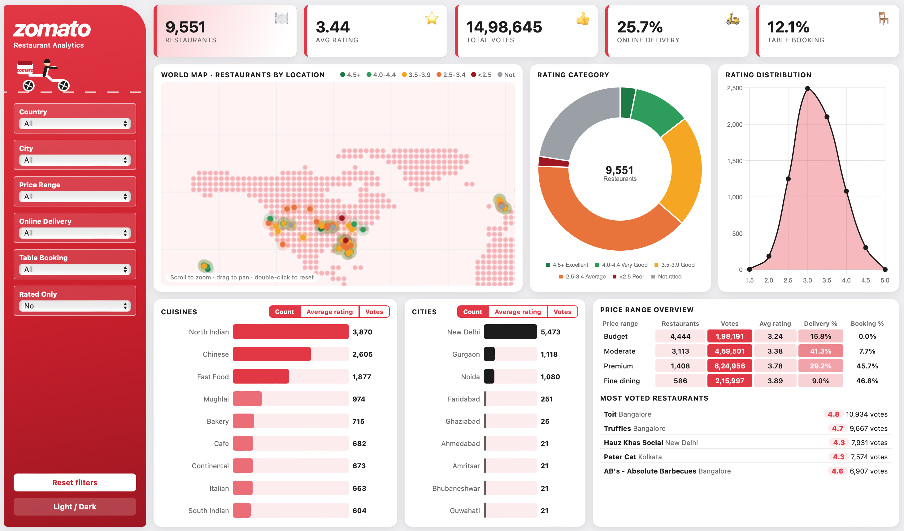

# Zomato Restaurant Analysis

Exploratory data analysis and an interactive dashboard of 9,551 Zomato restaurants, built with Python and a Power BI-style HTML dashboard.

## Tools Used
Python, Pandas, NumPy, Matplotlib, Seaborn, Google Colab, data visualisation power BI dashboard

## Dashboard Highlights
- **9,551 restaurants** analysed, with an average rating of **3.44**
- **14,98,645 total votes** across all restaurants
- Only **25.7%** of restaurants offer online delivery and **12.1%** offer table booking
- New Delhi has the most restaurants (5,473), followed by Gurgaon (1,118) and Noida (1,080)
- North Indian (3,870), Chinese (2,605) and Fast Food (1,877) are the most common cuisines
- Most voted restaurant: Toit, Bangalore (4.8 rating, 10,934 votes)

## Key Insights
- India has by far the most restaurants in the dataset, followed by the United States
- Ratings cluster between 3.0 and 3.8, and very few restaurants score above 4.5
- Higher price range means higher average rating: Budget 3.24, Moderate 3.38, Premium 3.78, Fine dining 3.89
- Table booking is rare in Budget restaurants (0%) but common in Premium (45.7%) and Fine dining (46.8%)
- Online delivery is highest in Moderate restaurants (41.3%) and lowest in Fine dining (9.0%)
- Restaurants with more votes tend to have higher ratings

## Charts

## Project Files
- `zomato_analysis.ipynb`: data cleaning and analysis notebook
- `data/`: raw and cleaned datasets
- `images/`: charts and dashboard screenshot

## Skills Demonstrated
Data cleaning, exploratory data analysis, data visualization, dashboard design
